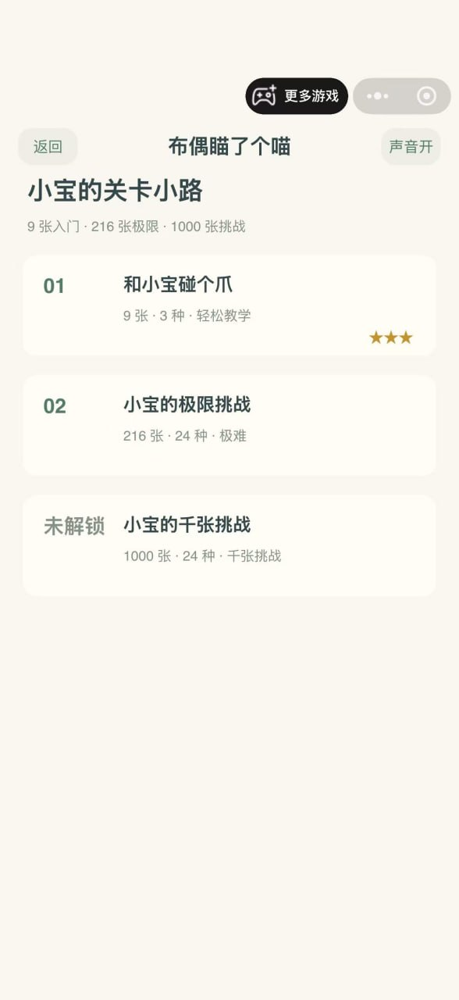

# 布偶喵了个喵

以布偶猫「小宝」为主角的微信三消小游戏，采用 24 张猫咪主题卡牌，包含教学、极限挑战和千张挑战三个关卡。

**上线状态：已在微信上架。** 当前仓库版本为 **1.01**；本次迭代更新项目介绍和本地启动说明，游戏玩法与 1.00 相同。仓库版本不等同于微信平台发布版本。

## 微信体验与游戏界面

在微信中搜索小游戏 **「布偶瞄了个喵」** 进入游戏。项目工作区名称为「布偶喵了个喵」，线上界面显示名称以微信为准。

下面是已上架游戏的关卡选择界面，由项目作者提供：

<p align="center">
  
</p>

| 关卡 | 名称 | 内容 |
| --- | --- | --- |
| 01 | 和小宝碰个爪 | 9 张卡牌、3 种图案，轻松教学 |
| 02 | 小宝的极限挑战 | 216 张卡牌、24 种图案 |
| 03 | 小宝的千张挑战 | 1000 张卡牌、24 种图案，逐关解锁 |

只有未被上层卡牌实际遮挡的牌可以点击；相邻的牌不会阻挡。收集槽有 7 格，3 张完全相同的牌自动消除；支持撤回、洗牌、寄存和复活，每局各一次。第三关包含 999 张三消牌和 1 张金边奖励牌，奖励牌直接收集、不占槽位。

## 在本地电脑启动

### Windows 双击启动

获取源码后，双击根目录的 **`start-preview.cmd`**。看到预览地址后，在浏览器打开 **http://127.0.0.1:4173** 即可试玩，运行期间保持命令窗口打开。

脚本优先使用系统安装的 Node.js；本机未安装时会尝试使用当前用户已有的 Codex Node.js 运行时。两者都没有时，按提示安装 Node.js LTS 后重新启动脚本。此方式不需要 npm。

### 1. 准备运行环境（命令行方式）

安装 [Node.js](https://nodejs.org/zh-cn/download) 的当前 LTS 版本（本项目最低要求 Node.js 18），然后重新打开终端，确认：

```powershell
node --version
npm --version
```

### 2. 获取项目

已安装 Git 时，在终端执行：

```powershell
git clone https://github.com/xiaodainiao/buou-miao-le-ge-miao.git
cd buou-miao-le-ge-miao
```

也可以在 GitHub 仓库页面选择 **Code → Download ZIP**，解压后打开项目文件夹，在该目录打开终端。

本机现有项目可以直接进入：

```powershell
cd "F:\CodexRecord\WeChatCodex\小宝布偶猫"
```

### 3. 启动浏览器试玩

```powershell
npm run preview
```

项目使用 Node.js 内置模块，**无需执行 `npm install`**。也可以直接运行：

```powershell
node tools/preview-server.js
```

看到 `Preview: http://127.0.0.1:4173` 后，在 Chrome、Edge 等浏览器中打开：

**http://127.0.0.1:4173**

启动期间保持终端打开，结束时按 **Ctrl+C** 停止。请通过上述地址访问，不要直接双击 `preview/index.html`。如果提示 `EADDRINUSE`，说明 4173 端口已被占用，请先关闭之前启动的预览服务后重试。

浏览器版用于本地玩法试玩，关卡进度保存在当前浏览器中，与微信正式版独立；微信胶囊按钮、平台登录等环境由微信提供，不包含在浏览器预览中。

## 在微信开发者工具中运行

如需运行完整微信小游戏工程，请安装微信开发者工具，选择「导入项目」：

- **目录**：项目根目录，即包含 `project.config.json` 的文件夹，不是 `game/` 子目录。
- **项目名称**：布偶喵了个喵。
- **AppID**：`wxf790ae3ae8fcb811`。
- **项目类型**：微信小游戏（`game`）。
- **小游戏目录**：`game/`，已在项目配置中指定。

无需新建模板或启用云开发。开发者工具登录、AppID 开发权限和真机扫码需使用有权限的微信账号。详细说明见 [微信小游戏导入说明](docs/微信小游戏导入说明.md)。

## 工程结构

| 路径 | 用途 |
| --- | --- |
| `game/` | 微信小游戏入口、Canvas 界面、同步后的规则和图片 |
| `miniprogram/core/` | 共用游戏规则源文件 |
| `miniprogram/assets/` | 共用卡牌素材；其余文件保留早期小程序原型 |
| `preview/` | 浏览器玩法预览界面 |
| `tools/` | 本地预览服务、同步工具 |
| `start-preview.cmd` | Windows 双击启动本地预览 |
| `tests/` | 游戏逻辑和小游戏工程检查 |
| `docs/` | 上架截图、素材说明、历史设计和验证记录 |

本地文件夹沿用「小宝布偶猫」名称，避免已有工具路径失效。

## 开发与检查

```powershell
# 修改共用规则或素材后，同步到微信小游戏目录
npm run sync:game

# 运行现有测试
npm test
```

历史验证详情见 [验收记录](docs/验收记录.md)。微信已上架的状态由项目作者于 2026-11-02 确认；历史文档中的「未发布」等描述属于当时的开发记录，不代表当前上线状态。

## 迭代版本

当前版本记录见 [CHANGELOG.md](CHANGELOG.md)，版本号见 [VERSION](VERSION)。

- [`v1.00`](https://github.com/xiaodainiao/buou-miao-le-ge-miao/tree/v1.00)：初始代码基线。
- [`v1.01`](https://github.com/xiaodainiao/buou-miao-le-ge-miao/tree/v1.01)：加入上架截图、微信已上架说明和本地启动指南，游戏功能未改动。

仓库地址使用拼音 `buou-miao-le-ge-miao`；GitHub 仓库名称仅允许 ASCII 字母、数字、点、连字符和下划线，中文项目名展示在本 README 和仓库简介中。
